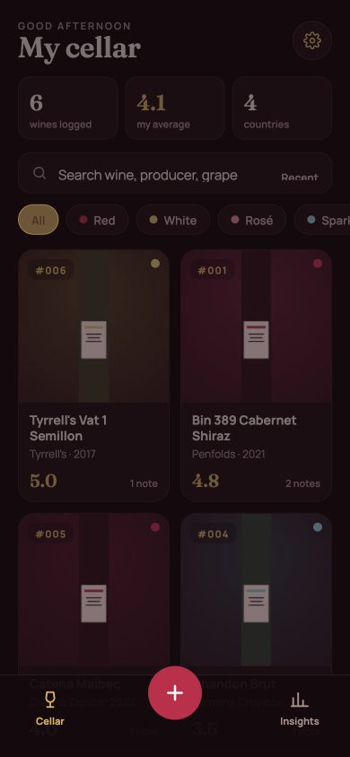
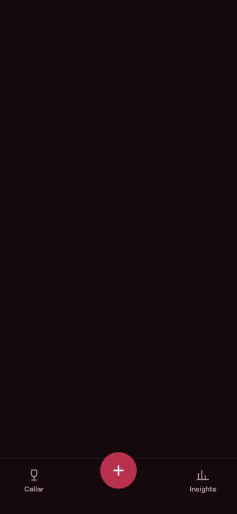
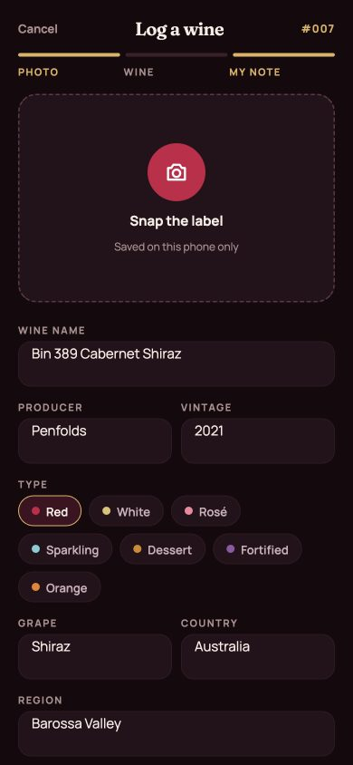
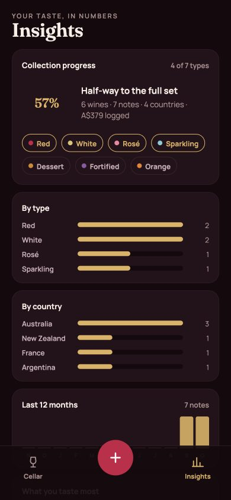

# 🍷 Wine Dex

**A Pokédex for wine — and it lives entirely on your phone.** Photograph the bottle, rate it, write what you tasted, and build your own numbered collection. No account, no server, no tracking: every wine, note and photo is stored in your device's own database and never leaves it.

**Open it:** https://willian-yudy-f.github.io/wine-dex/ — then *Add to Home Screen* and it works like an app, offline.

## In plain English
Vivino stores your wine notes on their servers. Wine Dex stores them on *your* phone, like a real Pokédex you carry around. Each bottle you log gets a number (#001, #002…), a photo of the label, your star rating, flavour tags and a note. The Insights tab turns that into your personal taste profile: which types and countries you drink, your top-rated bottles, best value, and how much you have logged. A one-tap backup file lets you move your cellar to a new phone.

| My cellar | Wine detail | Log a wine | Insights |
| --- | --- | --- | --- |
|  |  |  |  |

## Features
- **Local-first** — wines, notes and photos live in IndexedDB on the device. Nothing is uploaded, ever. Works with no internet after the first visit.
- **Snap the label** — uses the phone camera directly; photos are resized in the browser (1400 px + 480 px thumbnail) so the app stays fast.
- **Pokédex numbering** — every wine gets a permanent number in the order you discovered it.
- **Notes you can edit** — star rating with half steps, flavour tags, free text, price, place, date. Edit or delete any note; log the same wine again and the app keeps one entry per bottle (autocomplete while you type).
- **Insights** — collection progress by type, wines by type and country, last-12-months activity, flavours you taste most, top rated, best value, average spend.
- **Backup & restore** — export one JSON file (photos included) from Settings; restore it on any phone. Duplicates are skipped.
- **Installable PWA** — add to home screen on iOS/Android; service worker caches the app shell.

## Stack
| Layer | Choice | Why |
| --- | --- | --- |
| App | One `index.html`: vanilla HTML / CSS / JavaScript | No build step, loads instantly on a phone, easy to read |
| Storage | IndexedDB (three stores: `wines`, `tastings`, `photos`) with a 40-line wrapper, no library | Photos stored as real `Blob`s, not base64 strings; survives app restarts |
| Hosting | GitHub Pages | Free static hosting with HTTPS (required for the camera and PWA) |
| Offline | Service worker + web manifest | Opens without internet, installable |

```
index.html      app (UI + logic)
manifest.json   PWA manifest
sw.js           service worker (offline shell)
icon.svg        app icon
docs/           screenshots
```

### Data model
```
wines     (id, name, producer, vintage, type, grape, country, region, createdAt)
tastings  (id, wineId, rating, notes, tags[], photoId, price, place, tastedAt, createdAt)
photos    (id, full: Blob, thumb: Blob)
```

## Run it locally
Any static server works — for example `python3 -m http.server 8000` in this folder, then open `http://localhost:8000`. Your data stays in that browser's IndexedDB.

## Design
Designed first as four phone artboards in Claude Design, then built by hand: dark cellar ground `#140A0E`, gold accent `#D9B36A`, wine red `#B8304A`, Fraunces for display type and Manrope for text, inline SVG icons, 44 px touch targets.

## Roadmap
- [ ] Read the label with on-device OCR / AI to pre-fill name, producer and vintage
- [ ] Share a wine as an image card
- [ ] Optional cloud sync (Supabase) to compare notes with friends — an earlier version of this repo had it; the schema lives in the git history

## About
Built by [Willian Yudy Futema](https://willian-yudy-f.github.io/) — IT Support Coordinator at Merivale (Allianz Stadium & SCG) and a bartender for many years before that. MIT License.
